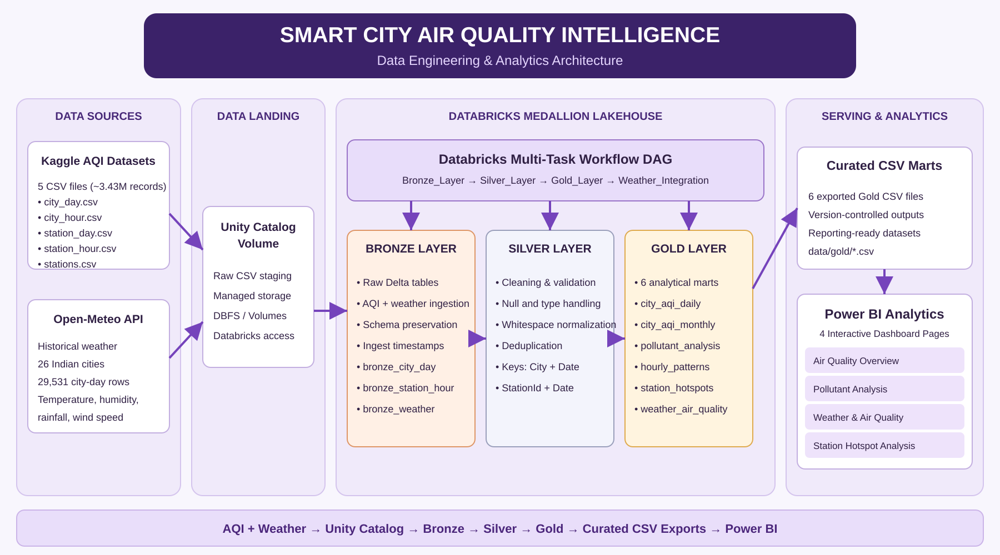

# Smart City – Air Quality and Pollution Intelligence

An end-to-end **data engineering and business intelligence project** analyzing historical air pollution across Indian cities. The solution combines air quality observations with historical weather data, processes them using a **Databricks Medallion Lakehouse (Bronze → Silver → Gold)**, and presents the results in a **four-page interactive Power BI report**.

## Project Overview

The project integrates daily and hourly city- and station-level air quality measurements from the Kaggle *Air Quality Data in India* dataset with historical meteorological observations from Open-Meteo. Python and PySpark support ingestion, data cleaning, validation, enrichment, and analytical aggregation. Databricks orchestrates the pipeline, and six curated Gold datasets are exported as CSV files for Power BI reporting.

### Project at a Glance

| Metric | Result |
| --- | ---: |
| Historical air quality records | **3,434,754** |
| Source air quality CSV files | **5** |
| Cities covered by weather integration | **26** |
| Historical weather records | **29,531** |
| Gold analytical datasets | **6** |
| Monitoring stations represented in the dashboard | **110** |
| Power BI report pages | **4** |
| Average AQI in the unfiltered overview | **166.5** |

> Dashboard metrics are based on the report's current data and may change when slicers or filters are applied.

## Technology Stack

| Technology | Role |
| --- | --- |
| Python | Data extraction, API requests, and pipeline scripting |
| Apache Spark (PySpark) | Distributed data transformation and aggregation |
| Databricks | Lakehouse processing and workflow orchestration |
| Delta Lake | Storage for Bronze, Silver, and Gold tables |
| Unity Catalog Volumes | Raw file landing and staging |
| Open-Meteo Historical Weather API | Historical temperature, humidity, rainfall, and wind speed |
| Power BI | Interactive analytics and visualization |
| Git and GitHub | Version control and project documentation |

## Data Sources

- **[Air Quality Data in India — Kaggle](https://www.kaggle.com/datasets/rohanrao/air-quality-data-in-india/data):** `city_day.csv`, `city_hour.csv`, `station_day.csv`, `station_hour.csv`, and `stations.csv`.
- **[Open-Meteo](https://open-meteo.com/):** Historical weather observations used for city-level weather and AQI analysis.

## System Architecture



**[View architecture diagram (SVG)](docs/Smart_City_Air_Quality_Architecture.svg)** · **[Read detailed architecture documentation](docs/03_Project_Architecture.md)**

```text
Kaggle Air Quality CSVs          Open-Meteo Historical Weather API
           |                                  |
           v                                  v
   Unity Catalog Volume               Python API Extraction
           |                                  |
           +----------------+-----------------+
                            |
                            v
                     Bronze Delta Tables
                            |
                            v
                  Silver Cleaned Tables
                            |
                            v
                   Gold Analytics Tables
                            |
                            v
                    Curated CSV Exports
                            |
                            v
                  Power BI (Four Pages)
```

The Databricks workflow includes **Bronze Layer**, **Silver Layer**, **Gold Layer**, and **Weather Integration** tasks. The diagram above summarizes the logical data flow; weather extraction and enrichment are handled within the implemented workflow.

### Bronze Layer — Raw Ingestion

Loads the five source air quality datasets into Bronze Delta tables and stages historical weather data for downstream processing.

### Silver Layer — Cleaning and Validation

Standardizes field types and text values, parses dates and timestamps, removes duplicates using appropriate business keys, and handles invalid or negative pollutant readings.

### Gold Layer — Analytics-Ready Data

Produces six curated analytical datasets:

| Gold table | Purpose |
| --- | --- |
| `gold_city_aqi_daily` | Daily city-level AQI trends and categories |
| `gold_city_aqi_monthly` | Monthly AQI summaries by city |
| `gold_pollutant_analysis` | Pollutant concentrations and comparisons |
| `gold_hourly_patterns` | Hourly pollution patterns |
| `gold_station_hotspots` | Monitoring-station AQI, maximum AQI, and status |
| `gold_weather_air_quality` | City AQI combined with historical weather variables |

The curated Gold datasets are **exported as CSV files and imported into Power BI**. The report is not described as a live DirectQuery connection.

## Power BI Dashboard

**[Open the Power BI report file (.pbix)](dashboard/Smart_City_Air_Quality_Dashboard.pbix)**

The report contains four interactive pages, each focused on a different aspect of air quality intelligence.

### 1. Air Quality Overview


Provides the overall average AQI, city and station counts, historical AQI trends, the most polluted cities, AQI category distribution, and Year/City slicers.

### 2. Pollutant Analysis


Compares average pollutant concentrations, shows pollutant trends over time, and supports city-level comparisons with Pollutant, Year, and City slicers.

### 3. Weather & Air Quality


Displays temperature, humidity, rainfall, and wind-speed KPIs alongside four weather-versus-AQI scatter plots, with Year and City slicers.

### 4. Station Hotspot Analysis


Highlights monitoring-station counts, average station AQI, top polluted stations, city-level station comparisons, operational status, and maximum station AQI, with a City slicer.

### Selected Dashboard Findings

- The unfiltered **Air Quality Overview** reports an average AQI of **166.5** across **26 cities**.
- The **Station Hotspot Analysis** covers **110 monitoring stations**, with an unfiltered average station AQI of **163.6**.
- **Ahmedabad** ranks highest in the displayed city-level average AQI comparison on the overview page.
- Filtering the station dashboard to **Delhi** shows **38 stations** and an average station AQI of **235.0**.
- The weather scatter plots support exploratory analysis of associations with AQI; **correlation does not establish causation**.

## Data Processing and Validation Results

| Metric | Result |
| --- | ---: |
| Raw air quality records | 3,434,754 |
| Historical weather records | 29,531 |
| Cities in weather integration | 26 |
| Curated Gold datasets | 6 |
| Monitoring stations in dashboard | 110 |
| Power BI report pages | 4 |
| Duplicate City–Date keys in final weather-enriched Gold table | 0 |

## Repository Structure

```text
Smart-City-Air-Quality-Intelligence/
├── data/
│   ├── raw/
│   ├── weather/
│   └── gold/
├── notebooks/
│   ├── 01_Bronze_Layer.py
│   ├── 02_Silver_Layer.py
│   ├── 03_Gold_Layer.py
│   └── 04_Weather_Data_Extraction.py
├── dashboard/
│   ├── Smart_City_Air_Quality_Dashboard.pbix
│   ├── Air Quality Overview.png
│   ├── Pollutant Analysis.png
│   ├── Weather & Air Quality.png
│   └── Station Hotspot Analysis.png
├── docs/
│   ├── 03_Project_Architecture.md
│   └── Smart_City_Air_Quality_Architecture.svg
├── requirements.txt
├── .gitignore
└── README.md
```

> The tree summarizes the main project assets. Check the repository for the exact contents of `data/` and any additional supporting files.

## Project Status

- [x] Project scope and problem statement
- [x] Air quality data ingestion
- [x] Bronze, Silver, and Gold data layers
- [x] Historical weather API integration
- [x] Databricks multi-task ETL workflow
- [x] Six curated Gold analytical datasets
- [x] Four-page interactive Power BI report
- [x] Dashboard PNG screenshots and PBIX file committed
- [x] Architecture diagram and technical documentation
- [x] GitHub repository synchronized
- [ ] Final project report
- [ ] Final presentation and demonstration

## Data Attribution

- **Air quality dataset:** [Air Quality Data in India — Kaggle](https://www.kaggle.com/datasets/rohanrao/air-quality-data-in-india/data)
- **Historical weather data:** [Open-Meteo](https://open-meteo.com/)

Dataset use and redistribution are subject to the respective providers' licensing, usage, and attribution requirements.
