# Smart City – Air Quality and Pollution Intelligence

An end-to-end **data engineering and business intelligence** project that integrates historical air quality measurements and meteorological data across Indian cities. It uses a **Databricks Medallion Lakehouse (Bronze → Silver → Gold)** to process the data and a **four-page Power BI report** to explore pollution trends, pollutant concentrations, weather relationships, and monitoring-station hotspots.

## Project Overview

The project brings together city- and station-level air quality observations from Kaggle with historical weather data from Open-Meteo. Python and PySpark handle ingestion, cleansing, enrichment, and analytical aggregations. A multi-task Databricks workflow orchestrates the pipeline, and six curated Gold datasets are exported for reporting in Power BI.

### Key Highlights

- **3,434,754** historical air quality records from **5 CSV files**
- **26** Indian cities covered by weather integration
- **29,531** historical weather records
- **6** Gold analytical datasets exported for analysis
- **110** monitoring stations represented in the station hotspot report
- **4** completed interactive Power BI dashboard pages
- **Average AQI: 166.5** in the unfiltered Air Quality Overview dashboard

> Dashboard metrics reflect the current report data and may change with filters.

## Tech Stack

| Technology | Purpose |
|---|---|
| **Python** | Data extraction, API requests, and pipeline scripting |
| **Apache Spark (PySpark)** | Distributed transformations and analytical aggregations |
| **Databricks** | Lakehouse processing and multi-task workflow orchestration |
| **Delta Lake** | Bronze, Silver, and Gold table storage |
| **Unity Catalog Volumes** | Raw data landing and staging |
| **Open-Meteo Historical Weather API** | Historical temperature, humidity, precipitation, and wind speed |
| **Power BI** | Completed interactive analytics report |
| **GitHub** | Version control and project documentation |

## Data Sources

1. **[Air Quality Data in India – Kaggle](https://www.kaggle.com/datasets/rohanrao/air-quality-data-in-india/data)** — city- and station-level daily/hourly pollution observations from `city_day.csv`, `city_hour.csv`, `station_day.csv`, `station_hour.csv`, and `stations.csv`.
2. **[Open-Meteo](https://open-meteo.com/)** — historical daily weather variables, including temperature, relative humidity, precipitation, and maximum wind speed.

## Data Pipeline Architecture

```text
Raw CSV Files + Weather API → Bronze Layer → Silver Layer → Gold Layer → Power BI Dashboard
```

> **Detailed Architecture Documentation & Diagram:**
> - [System Architecture Specification](docs/03_Project_Architecture.md)
> - [Interactive Architecture Diagram (HTML)](docs/project_architecture_diagram.html)
> - [Vector Architecture Diagram (SVG)](docs/project_architecture_diagram.svg)



### Bronze Layer

Ingests raw air quality datasets into Delta tables and extracts historical weather data.

### Silver Layer — Cleaning and Validation

Standardizes text and data types, handles invalid or negative pollutant measurements, parses dates and timestamps, and removes duplicate records using relevant business keys.

### Gold Layer — Analytics-Ready Data

Produces six curated analytical tables:

| Gold table | Analytical purpose |
|---|---|
| `gold_city_aqi_daily` | Daily city AQI trends and category distribution |
| `gold_city_aqi_monthly` | Monthly city-level AQI summaries |
| `gold_pollutant_analysis` | Pollutant concentrations and comparisons |
| `gold_hourly_patterns` | Hourly pollution patterns |
| `gold_station_hotspots` | Station-level AQI, maximum AQI, and operational status |
| `gold_weather_air_quality` | Weather variables joined with city air quality observations |

The six curated datasets are exported as CSV files for Power BI reporting and reproducible analysis.

## Power BI Dashboard

The completed report, **`Smart_City_Air_Quality_Dashboard.pbix`**, contains four pages:

| Page | Key visualizations |
|---|---|
| **1. Air Quality Overview** | Average AQI, total cities, total stations, historical AQI trend, top polluted cities, AQI category distribution, and Year/City slicers |
| **2. Pollutant Analysis** | Average concentration by pollutant, pollutant trends over time, city-level pollutant comparisons, and Pollutant/Year/City slicers |
| **3. Weather & Air Quality** | Temperature, humidity, rainfall, and wind-speed KPIs; four weather-versus-AQI scatter plots; Year/City slicers |
| **4. Station Hotspot Analysis** | Station count, average station AQI, top polluted stations, top cities by station AQI, operational status donut, maximum station AQI by city, and City slicer |

### Selected Dashboard Findings

- The **Air Quality Overview** page reports an overall average AQI of **166.5** across **26 cities**.
- The **Station Hotspot Analysis** page covers **110 monitoring stations**, with an average station AQI of **163.6** in the unfiltered view.
- **Ahmedabad** leads the displayed city-level average AQI rankings in the overview and station hotspot comparisons.
- The station dashboard's City slicer was tested with **Delhi**, returning **38 stations** and an average station AQI of **235.0**.
- Weather scatter plots allow visual exploration of relationships between AQI and temperature, humidity, precipitation, and wind speed; they do **not**, by themselves, establish causation.

## Processing Results

| Metric | Result |
|---|---:|
| Raw air quality records | 3,434,754 |
| Historical weather records | 29,531 |
| Cities in weather integration | 26 |
| Gold analytical datasets | 6 |
| Monitoring stations in dashboard | 110 |
| Power BI dashboard pages | 4 |
| Duplicate City–Date keys in final weather-enriched Gold table | 0 |

## Repository Structure

```text
Smart-City-Air-Quality-Intelligence/
├── data/
│   ├── raw/
│   ├── weather/
│   └── gold/                    # Curated CSV exports
├── notebooks/
│   ├── 01_Bronze_Layer.py
│   ├── 02_Silver_Layer.py
│   ├── 03_Gold_Layer.py
│   └── 04_Weather_Data_Extraction.py
├── dashboard/
│   └── Smart_City_Air_Quality_Dashboard.pbix
├── docs/
│   ├── 03_Project_Architecture.md
│   └── Smart_City_Air_Quality_Architecture.svg
├── requirements.txt
├── .gitignore
└── README.md
```

> This is the intended repository layout. Verify that the exported CSVs, PBIX file, and updated documentation are committed at these paths before publishing links or submitting the project.

## Project Status

- [x] Project scope and problem statement
- [x] Air quality data ingestion
- [x] Bronze, Silver, and Gold data layers
- [x] Historical weather API integration
- [x] Databricks multi-task ETL workflow
- [x] Six curated Gold analytical datasets
- [x] Four-page Power BI report
- [x] Architecture diagram and documentation drafted
- [ ] Verify final repository files and links
- [ ] Final project report
- [ ] Final presentation

## Data Attribution

- **Air quality dataset:** [Air Quality Data in India – Kaggle](https://www.kaggle.com/datasets/rohanrao/air-quality-data-in-india/data)
- **Historical weather data:** [Open-Meteo](https://open-meteo.com/)

Dataset redistribution is subject to each provider's licensing, usage, and attribution requirements.

Dataset redistribution is subject to the respective providers' licensing and attribution requirements.