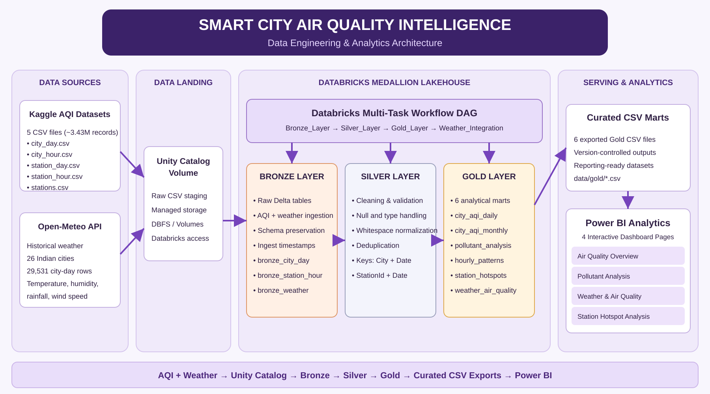
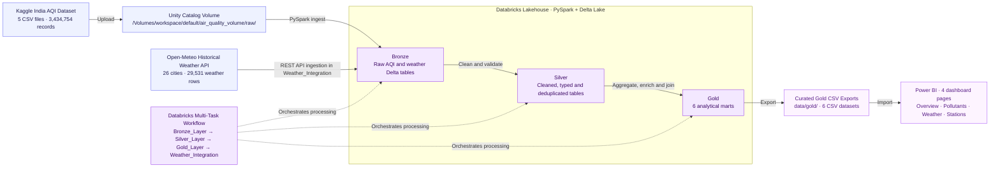

# System Architecture: Smart City – Air Quality and Pollution Intelligence

## 1. High-Level Architecture Overview

**Smart City – Air Quality and Pollution Intelligence** is an end-to-end data engineering and business intelligence project that ingests, cleans, models, and visualizes historical air quality and weather information across **26 Indian cities**.

The solution uses **Databricks**, **Apache Spark (PySpark)**, **Delta Lake**, and the **Bronze → Silver → Gold medallion architecture**. The resulting six curated Gold datasets are exported as CSV marts and used to build a **four-page Power BI report**.

**End-to-end flow:** Kaggle AQI CSVs + Open-Meteo historical weather → Databricks ingestion and staging → Bronze/Silver/Gold processing → curated Gold CSV exports → Power BI dashboards.

---

## 2. Project Architecture Diagram

The updated diagram shows the implemented data flow, including the curated CSV exports that feed Power BI.

- **Standalone editable SVG:** [Smart City Air Quality Architecture](Smart_City_Air_Quality_Architecture.svg)

> **Repository note:** Place `Smart_City_Air_Quality_Architecture.svg` alongside this Markdown file, or update the relative link to its location in your repository.

---

## 3. GitHub-Compatible Architecture Flowchart (Mermaid)

**Workflow execution order:** The Databricks job executes `Bronze_Layer → Silver_Layer → Gold_Layer → Weather_Integration`. The final weather task performs weather ingestion and weather-related Bronze/Silver/Gold integration after the main AQI Gold processing. The Mermaid diagram represents logical data movement; the job sequence is shown separately in the workflow node.

---

## 4. Architectural Layers and Components

### 4.1 Ingestion and external sources

**Kaggle — Air Quality Data in India**

- **Raw entries:** 3,434,754.
- **Five CSV files:** `city_day.csv`, `city_hour.csv`, `station_day.csv`, `station_hour.csv`, and `stations.csv`.
- **Raw landing location:** `/Volumes/workspace/default/air_quality_volume/raw/` in a Databricks Unity Catalog Volume.

**Open-Meteo Historical Weather API**

- **Coverage:** 26 Indian cities, using geographic coordinates.
- **Historical alignment:** 2015-01-01 to 2020-07-01.
- **Weather fields:** mean temperature (°C), relative humidity (%), precipitation (mm), and maximum wind speed (km/h).
- **Weather records:** 29,531 daily rows, retrieved with Python requests and retry/rate-limiting logic.

### 4.2 Medallion data architecture

| Layer | Implementation | Delta tables | Main operations |
|---|---|---|---|
| **Bronze** | `01_Bronze_Layer.py`; weather processing in `04_Weather_Data_Extraction.py` | `bronze_city_day`, `bronze_city_hour`, `bronze_station_day`, `bronze_station_hour`, `bronze_stations`, `bronze_weather` | Ingest source data, retain raw schema and provenance, add ingestion timestamps. |
| **Silver** | `02_Silver_Layer.py`; weather processing in `04_Weather_Data_Extraction.py` | `silver_city_day`, `silver_city_hour`, `silver_station_day`, `silver_station_hour`, `silver_stations`, `silver_weather` | Trim text, replace invalid/negative pollutant values with null, cast dates, deduplicate on appropriate business keys. |
| **Gold** | `03_Gold_Layer.py`; weather integration in `04_Weather_Data_Extraction.py` | `gold_city_aqi_daily`, `gold_city_aqi_monthly`, `gold_pollutant_analysis`, `gold_hourly_patterns`, `gold_station_hotspots`, `gold_weather_air_quality` | Aggregate AQI and pollutants, build city/station comparisons, compute hourly patterns, and join weather with AQI. |

### 4.3 Workflow orchestration

The Databricks multi-task workflow (`Smart_City_Air_Quality_ETL_Pipeline.json`) runs four dependent tasks:

1. **`Bronze_Layer`** — executes `01_Bronze_Layer.py` to ingest the five AQI source files into raw Delta tables.
2. **`Silver_Layer`** — executes `02_Silver_Layer.py` to clean and deduplicate AQI data; depends on Bronze.
3. **`Gold_Layer`** — executes `03_Gold_Layer.py` to produce the five core AQI analytical marts; depends on Silver.
4. **`Weather_Integration`** — executes `04_Weather_Data_Extraction.py` to retrieve weather, populate `bronze_weather` and `silver_weather`, and create `gold_weather_air_quality`; depends on Gold.

### 4.4 Curated exports and Power BI

Six Gold datasets are exported to `data/gold/*.csv` for reproducible downstream analytics and Power BI import. **The implemented reporting path is Gold → CSV exports → Power BI**, not a live DirectQuery connection.

The Power BI report contains these **four completed pages**:

| Dashboard page | Implemented visuals |
|---|---|
| **1. Air Quality Overview** | Average AQI, total cities, total stations, AQI trend over time, Top 10 polluted cities, AQI category distribution, Year and City slicers. |
| **2. Pollutant Analysis** | Average pollutant concentration, multi-pollutant historical trends, city/pollutant comparisons, Pollutant/Year/City slicers. |
| **3. Weather & Air Quality** | Temperature, humidity, rainfall, and wind-speed KPIs; four weather-versus-AQI scatter charts; Year and City slicers. |
| **4. Station Hotspot Analysis** | Total stations, average station AQI, Top 10 polluted monitoring stations, Top 10 cities by station AQI, station operational status donut, maximum station AQI by city, City slicer. |

**Important:** Page 4 uses station rankings and status charts, **not a geospatial hotspot map**. Page 3 uses weather-versus-AQI scatter plots, **not a correlation matrix**. The `gold_hourly_patterns` mart is available in the analytical outputs, but a separate diurnal-pattern dashboard is not one of the four completed pages.

---

## 5. Gold Analytical Marts Schema Reference

| Gold table | Representative columns and purpose |
|---|---|
| `gold_city_aqi_daily` | `City`, `Date`, `AQI`, `AQI_Bucket`, `PM25`, `PM10`, `NO2`, `SO2`, `CO`, `O3` — daily AQI and pollutant analysis. |
| `gold_city_aqi_monthly` | `City`, `Year`, `Month`, `Avg_AQI`, `Max_AQI`, `Avg_PM25`, `Avg_PM10`, `AQI_Observations`, `Total_Days` — monthly summaries. |
| `gold_pollutant_analysis` | `City`, `Date`, `Pollutant`, `Concentration` — unpivoted pollutant comparisons. |
| `gold_hourly_patterns` | `City`, `Hour`, `Avg_AQI`, `AQI_Observations` — 24-hour pollution patterns. |
| `gold_station_hotspots` | `StationId`, `StationName`, `City`, `State`, `Avg_AQI`, `Max_AQI`, `AQI_Observations`, `Status` — monitoring station rankings and operational status. |
| `gold_weather_air_quality` | `City`, `Date`, `AQI`, `AQI_Bucket`, `PM25`, `PM10`, `Temperature_C`, `Humidity_Percent`, `Precipitation_mm`, `Max_Wind_Speed_kmh`, `Latitude`, `Longitude` — weather-enriched AQI data. |

> Column lists are representative of the project documentation and dashboard fields; inspect the exported CSV headers for the definitive schema before writing SQL or DAX against them.

---

## 6. Data Integrity and Key Processing Metrics

| Metric | Value / implementation |
|---|---|
| Kaggle raw AQI records | **3,434,754** |
| Open-Meteo weather rows | **29,531** |
| Combined raw/source row count | **3,464,285** (sum of the two source counts; not a deduplicated Gold count) |
| Cities analyzed | **26** |
| Monitoring stations shown in Power BI | **110** |
| City-level daily AQI rows | **29,531** (project dataset count) |
| Gold marts exported | **6** |
| Power BI report pages | **4** |
| Duplicate business keys | Reported as **0** in the original processing notes for checked Gold keys; verify from pipeline quality logs before claiming this for every Gold table. |
| Delta Lake | Provides ACID transaction support for Delta tables. |

### Example Power BI dashboard findings

- **Air Quality Overview:** Average AQI **166.5**, **26** cities, **110** monitoring stations.
- **Station Hotspot Analysis:** Average station AQI **163.6** across all selected stations.
- **Delhi slicer validation:** **38** stations and average station AQI **235.0**; the station and city visuals updated with the filter.
- **Weather & Air Quality:** Mean temperature **25.6°C**, humidity **67.8%**, daily rainfall **3.2 mm**, and maximum wind speed **15.7 km/h** in the unfiltered report view.

These are **observed Power BI dashboard values**, which may vary when report filters are changed.

---

## 7. Project Artifacts

- Databricks notebooks/scripts: `01_Bronze_Layer.py`, `02_Silver_Layer.py`, `03_Gold_Layer.py`, `04_Weather_Data_Extraction.py`.
- Workflow configuration: `Smart_City_Air_Quality_ETL_Pipeline.json`.
- Exported analytics datasets: `data/gold/*.csv` (six files).
- Power BI report: `Smart_City_Air_Quality_Dashboard.pbix`.
- Architecture diagram: `Smart_City_Air_Quality_Architecture.svg`.

**Repository:** https://github.com/Rudra-AI-2127/Smart-City-Air-Quality-Intelligence
