# System Architecture: Smart City – Air Quality and Pollution Intelligence

## 1. High-Level Architecture Overview

The **Smart City – Air Quality and Pollution Intelligence** platform is an end-to-end cloud data engineering and business intelligence solution designed to ingest, process, clean, model, and visualize longitudinal air quality and meteorological data across 26 major Indian cities.

The architecture leverages the **Databricks Lakehouse Platform**, **Apache Spark (PySpark)**, **Delta Lake**, and **Power BI**, following the industry-standard **Medallion Architecture (Bronze → Silver → Gold)**.

---

## 2. Project Architecture Diagram

Interactive and standalone vector diagrams designed per the editorial Design System:
- **Interactive Web Diagram (HTML + SVG):** [project_architecture_diagram.html](project_architecture_diagram.html)
- **Standalone Vector Diagram (SVG):** [project_architecture_diagram.svg](project_architecture_diagram.svg)

### Embedded Architecture Diagram


---

## 3. GitHub Markdown Architecture Flowchart (Mermaid)

```mermaid
flowchart LR
    subgraph SOURCELAYER["Data Ingestion & Sources"]
        direction TB
        SRC_KAGGLE["Kaggle AQI Datasets<br/><i>3.43M records · 5 CSV files</i>"]
        SRC_VOLUME["Unity Catalog Volume<br/><i>/Volumes/.../raw/</i>"]
        SRC_WEATHER["Open-Meteo Weather API<br/><i>26 cities · 29,531 rows</i>"]
        SRC_KAGGLE -->|Upload| SRC_VOLUME
    end

    subgraph LAKEHOUSE["Databricks Lakehouse (PySpark & Delta Lake)"]
        direction TB
        
        subgraph ORCHESTRATOR["Databricks Multi-Task Workflow DAG"]
            DAG_TASK["01_Bronze → 02_Silver → 03_Gold → 04_Weather"]
        end

        subgraph BRONZELAYER["Bronze Tier (Raw Delta Tables)"]
            B1["bronze_city_day / hour"]
            B2["bronze_station_day / hour"]
            B3["bronze_stations"]
            B4["bronze_weather"]
        end

        subgraph SILVERLAYER["Silver Tier (Cleaned & Validated)"]
            S1["Whitespace trimming & null replacement"]
            S2["Filter negative values (pollutants >= 0)"]
            S3["Date & Datetime type casting"]
            S4["Deduplication by composite business keys"]
        end

        subgraph GOLDLAYER["Gold Tier (Curated Analytical Marts)"]
            G1["gold_city_aqi_daily"]
            G2["gold_city_aqi_monthly"]
            G3["gold_pollutant_analysis"]
            G4["gold_hourly_patterns"]
            G5["gold_station_hotspots"]
            G6["gold_weather_air_quality"]
        end

        ORCHESTRATOR -.->|Task 1| BRONZELAYER
        ORCHESTRATOR -.->|Task 2| SILVERLAYER
        ORCHESTRATOR -.->|Tasks 3+4| GOLDLAYER

        BRONZELAYER -->|PySpark Cleansing| SILVERLAYER
        SILVERLAYER -->|Enrichment & Joins| GOLDLAYER
    end

    subgraph SERVINGLAYER["Serving & Intelligence"]
        direction TB
        BI["Power BI Dashboard<br/><i>Interactive Trends, Hotspots & Weather Correlation</i>"]
        CSV_OUT["Curated CSV Marts<br/><i>data/gold/*.csv directory</i>"]
    end

    SRC_VOLUME -->|PySpark Read| BRONZELAYER
    SRC_WEATHER -->|REST API Ingest| BRONZELAYER
    GOLDLAYER -->|Direct Query / Import| BI
    GOLDLAYER -->|CSV Sync| CSV_OUT

    classDef focal fill:#fef3f0,stroke:#bf4520,stroke-width:2px,color:#bf4520;
    classDef standard fill:#ffffff,stroke:#2d3142,stroke-width:1px,color:#2d3142;
    classDef api fill:#ffffff,stroke:#2e5aa8,stroke-width:1.5px,color:#2e5aa8;
    class GOLDLAYER,G6,BI focal;
    class SRC_WEATHER api;
    class BRONZELAYER,SILVERLAYER,SRC_VOLUME,CSV_OUT standard;
```



---

## 4. Architectural Layers & Component Breakdown

### 4.1 Ingestion & External Sources
1. **Kaggle Air Quality in India Dataset:**
   - **Records:** 3,434,754 raw entries.
   - **Files:** `city_day.csv`, `city_hour.csv`, `station_day.csv`, `station_hour.csv`, `stations.csv`.
   - **Staging:** Ingested into Databricks Unity Catalog Volume at `/Volumes/workspace/default/air_quality_volume/raw/`.
2. **Open-Meteo Historical Weather API:**
   - **Coverage:** 26 Indian cities with geocoded coordinates (Latitude/Longitude).
   - **Date Range:** Synchronized to air quality historical span (2015-01-01 to 2020-07-01).
   - **Metrics:** Daily mean temperature (°C), mean relative humidity (%), precipitation sum (mm), and maximum wind speed (km/h).
   - **Records:** 29,531 daily weather records extracted via Python requests with rate-limiting and retry logic.

### 4.2 Medallion Architecture (Storage & Transformation)

| Medallion Layer | Implementation Script | Target Delta Tables | Transformation Logic |
|---|---|---|---|
| **Bronze** | `01_Bronze_Layer.py`<br/>`04_Weather_Data_Extraction.py` | `bronze_city_day`<br/>`bronze_city_hour`<br/>`bronze_station_day`<br/>`bronze_station_hour`<br/>`bronze_stations`<br/>`bronze_weather` | Direct schema-inferred ingestion from raw CSV and API JSON payloads into Delta Lake tables; attaches ingestion timestamp; preserves complete raw data lineage. |
| **Silver** | `02_Silver_Layer.py`<br/>`04_Weather_Data_Extraction.py` | `silver_city_day`<br/>`silver_city_hour`<br/>`silver_station_day`<br/>`silver_station_hour`<br/>`silver_stations`<br/>`silver_weather` | Data quality enforcement: trims text columns, replaces invalid/negative pollutant values with `NULL`, casts `Date` and `Datetime` strings into native temporal types, deduplicates records using composite business keys (`[City, Date]`, `[StationId, Date]`, `[City, Datetime]`). |
| **Gold** | `03_Gold_Layer.py`<br/>`04_Weather_Data_Extraction.py` | `gold_city_aqi_daily`<br/>`gold_city_aqi_monthly`<br/>`gold_pollutant_analysis`<br/>`gold_hourly_patterns`<br/>`gold_station_hotspots`<br/>`gold_weather_air_quality` | Analytical modeling & aggregations: creates daily city AQI summaries, calculates monthly rolling statistics (Avg AQI, Max AQI, PM2.5, PM10), unpivots pollutants for comparative breakdown, aggregates 24-hour diurnal trends, enriches monitoring stations with geographic metadata, and joins meteorological variables with air quality. |

### 4.3 Orchestration & Workflow Engine
The automated pipeline is defined as a unified multi-task Databricks Workflow DAG (`Smart_City_Air_Quality_ETL_Pipeline.json`):
1. **Task 1: `Bronze_Layer`** (`01_Bronze_Layer.py`) – Ingests raw CSVs into Bronze Delta tables.
2. **Task 2: `Silver_Layer`** (`02_Silver_Layer.py`) – Runs data cleansing and business-key deduplication (depends on `Bronze_Layer`).
3. **Task 3: `Gold_Layer`** (`03_Gold_Layer.py`) – Produces the first 5 analytical Gold tables (depends on `Silver_Layer`).
4. **Task 4: `Weather_Integration`** (`04_Weather_Data_Extraction.py`) – Queries Open-Meteo API, produces `bronze_weather`, `silver_weather`, and creates the final joined `gold_weather_air_quality` table (depends on `Gold_Layer`).

### 4.4 Serving & Analytics Layer
- **Power BI Dashboard:** Direct connection to the 6 Gold Delta tables/CSVs providing interactive dashboards:
  - *Overview & City Rankings:* City AQI comparisons and distribution across CPCB AQI buckets.
  - *Diurnal Patterns:* Peak morning and evening rush-hour pollution spikes by hour.
  - *Station Hotspots:* Geospatial mapping of high-AQI stations enriched with station names and states.
  - *Meteorological Drivers:* Correlation matrix exploring the impact of wind speed, humidity, and temperature on PM2.5 and AQI dispersion.
- **Curated CSV Marts:** Exported datasets maintained in `data/gold/` for open-source reproducibility, ML research, and exploratory analysis.

---

## 5. Gold Analytical Marts Schema Reference

```
┌─────────────────────────────────────────────────────────────────────────────┐
│                           GOLD ANALYTICS DATA MARTS                         │
├───────────────────────────┬─────────────────────────────────────────────────┤
│ Table Name                │ Key Columns & Description                       │
├───────────────────────────┼─────────────────────────────────────────────────┤
│ gold_city_aqi_daily       │ City, Date, AQI, AQI_Bucket, PM25, PM10, NO2,   │
│                           │ SO2, CO, O3 (Standardized daily city index)     │
├───────────────────────────┼─────────────────────────────────────────────────┤
│ gold_city_aqi_monthly     │ City, Year, Month, Avg_AQI, Max_AQI, Avg_PM25,  │
│                           │ Avg_PM10, AQI_Observations, Total_Days          │
├───────────────────────────┼─────────────────────────────────────────────────┤
│ gold_pollutant_analysis   │ City, Date, Pollutant, Concentration            │
│                           │ (Normalized unpivoted pollutant metrics)        │
├───────────────────────────┼─────────────────────────────────────────────────┤
│ gold_hourly_patterns      │ City, Hour (0-23), Avg_AQI, AQI_Observations    │
│                           │ (Diurnal pollution distribution)                │
├───────────────────────────┼─────────────────────────────────────────────────┤
│ gold_station_hotspots     │ StationId, StationName, City, State, Latitude,  │
│                           │ Longitude, Avg_AQI, Max_AQI, AQI_Observations   │
├───────────────────────────┼─────────────────────────────────────────────────┤
│ gold_weather_air_quality  │ City, Date, AQI, AQI_Bucket, PM25, PM10,        │
│                           │ Temperature_C, Humidity_Percent,                │
│                           │ Precipitation_mm, Max_Wind_Speed_kmh,           │
│                           │ Latitude, Longitude (Enriched ML Mart)          │
└───────────────────────────┴─────────────────────────────────────────────────┘
```

---

## 6. Data Integrity & Key Processing Metrics

- **Total Ingested Records:** `3,464,285` (3,434,754 Air Quality + 29,531 Weather).
- **Target Cities Analyzed:** `26` major Indian urban centers.
- **Duplicate Keys in Final Gold Layer:** `0` duplicate `[City, Date]` or `[StationId, Date]` combinations.
- **ACID Transaction Guarantees:** 100% managed via Delta Lake format in Databricks.
